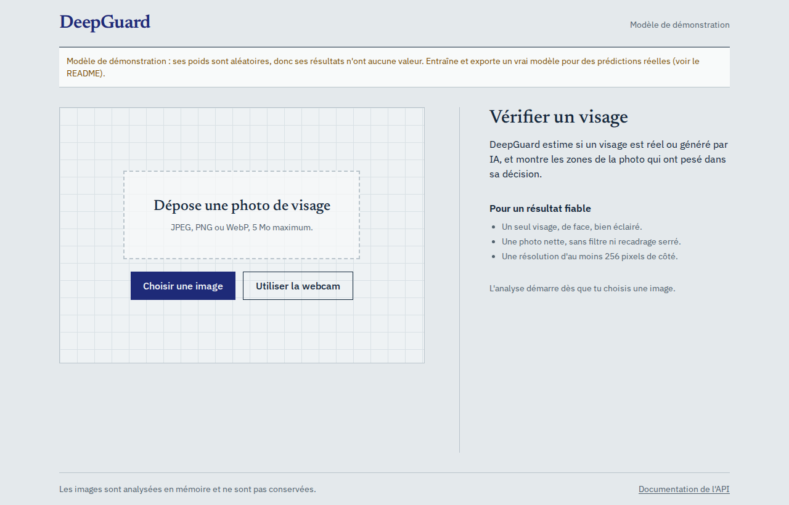
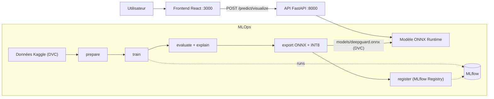

# DeepGuard


Détection de **visages générés par IA** (deepfakes : réel vs StyleGAN) avec explication visuelle de la décision, servie
par une application web et industrialisée avec un cycle de vie MLOps complet.

Projet de module **Deep Learning Avancé**, **Axe 4 : Vision Transformers** (benchmark ViT-B/16 contre une baseline CNN et
EfficientNet-V2-S, Attention Rollout affichée dans le frontend), TEK-UP University 2026-2027.
Réalisé par Sourour Ben Salha et Ghaith Aouissaoui, encadré par M. Haythem Ghazouani.



## Où voir quoi

| Je corrige… | Je regarde | Fichiers |
|---|---|---|
| **Deep Learning Avancé** (modélisation, rigueur scientifique, full-stack) | Trois architectures comparées, ViT (patchs, embeddings de position, auto-attention), métriques, explicabilité, export ONNX + quantification, API et interface | `src/`, `params.yaml`, `notebooks/kaggle_train.ipynb`, `backend/`, `frontend/`, `docs/rapport/` |
| **MLOps** | Pipeline reproductible DVC, suivi MLflow et Model Registry, Docker multi-stage, CI/CD GitHub Actions, tests, monitoring | `dvc.yaml`, `.dvc/`, `src/models/register.py`, `.github/workflows/`, `docker-compose.yml`, `*/Dockerfile`, `mlflow/`, `monitoring/`, `tests/`, `backend/tests/` |

L'historique Git (commits et Pull Requests) montre la contribution de chacun dans les deux parties.

## Démarrage rapide (sans entraînement)

Prérequis : Docker Desktop.

```bash
docker-compose up --build        # ou : docker compose up --build
```

- Interface : http://localhost:3000
- API et documentation Swagger : http://localhost:8000/docs

Tant qu'aucun modèle entraîné n'existe dans `models/`, l'API charge un **modèle de démonstration aux poids aléatoires**.
L'interface l'indique par un bandeau : ses résultats n'ont aucune valeur. Il sert à vérifier que toute la chaîne
fonctionne. Pour de vrais résultats, voir « Entraîner un vrai modèle ».

Test de fumée de l'application lancée : `pip install httpx pillow && python scripts/smoke_test.py`.

### Sans Docker (développement)

```bash
python -m venv .venv
source .venv/Scripts/activate            # Windows (Git Bash) ; Linux/Mac : source .venv/bin/activate
pip install -r backend/requirements-dev.txt
uvicorn app.main:app --app-dir backend --reload          # API sur :8000

cd frontend && npm install && npm run dev                # interface sur :3000 (dans un 2e terminal)
```

## Conformité au cahier des charges

| Exigence du guide | Où / comment | État |
|---|---|---|
| Axe 4 : stratégie de patchification et embeddings de position | ViT-B/16 : grille 14x14 = 196 patchs + token CLS, embeddings de position appris `(1, 197, 768)`, journalisés dans MLflow (`describe_vit`, `src/models/architecture.py`) | Fait |
| Axe 4 : matrices d'attention (Attention Rollout) affichées dans le frontend | `src/utils/gradcam.py`, exportées DANS l'ONNX (`ViTWithRollout`, sortie `cam`), calque affiché avec curseur de comparaison | Fait (test CI sur ViT tiny) |
| Benchmark contre une baseline CNN | `notebooks/kaggle_train.ipynb` : baseline CNN, EfficientNet-V2-S, ViT-B/16 | **À exécuter** |
| Métriques, généralisation | accuracy, F1, ROC-AUC, matrice de confusion, 2e dataset (`src/models/evaluate.py`) | **À exécuter** |
| Export ONNX + ONNX Runtime, quantification | `src/models/export_onnx.py` : parité PyTorch/ONNX, latence, INT8 (`src/utils/quantize.py`) | Fait (INT8 testé sur le modèle de démo) |
| FastAPI : `/health` (GPU, version), `/model/metadata`, `/predict`, `/predict/visualize`, Pydantic, 400 / 503 | `backend/app/` | Fait (12 tests) |
| Frontend : drag & drop, galerie, webcam, barres de probabilité animées, latence client + serveur | `frontend/src/` | Fait. **Galerie : lancer `scripts/export_samples.py`** |
| DVC : données brutes + checkpoints | `dvc add data/raw` (crée `data/raw.dvc`), `dvc.yaml`, `dvc push` | **À exécuter** (remote DagsHub déclaré) |
| MLflow : tracking + Model Registry (Staging / Production) | `src/models/train.py`, `src/models/register.py` : alias `staging` et `production` (les « stages » sont dépréciés par MLflow) | Fait (registre testé) |
| Docker multi-stage + `docker-compose up --build` | `backend/Dockerfile`, `frontend/Dockerfile`, `docker-compose.yml` | Fait (non exécuté dans l'environnement de rédaction : voir la CI) |
| CI/CD : lint, pytest, build des conteneurs | `.github/workflows/ci-tests.yml`, `docker-build.yml` (ruff remplace flake8 + black, oxlint remplace ESLint) | Fait. **À vérifier : premier run vert** |
| Rapport LaTeX, README, `rapport_technique.pdf` | `docs/rapport/main.tex`, ce README | **À compléter** avec les résultats |

## Architecture



| Composant | Rôle |
|---|---|
| `frontend/` | React + Vite + Tailwind : `Dropzone`, `Webcam`, `HeatmapCanvas`, `ProbabilityChart`, `Samples`, `services/api.js` |
| `backend/` | API FastAPI : validation, recadrage du visage (OpenCV), inférence ONNX Runtime, métriques Prometheus |
| `src/data/` | Dataset PyTorch, transformations, listes de fichiers (`prepare.py`) |
| `src/models/` | Architectures, entraînement, évaluation, export ONNX, enregistrement MLflow |
| `src/utils/` | CAM et Attention Rollout (`gradcam.py`), quantification, métriques, configuration |
| `dvc.yaml` | Pipeline `prepare → train → evaluate / explain / export → register` |
| `backend/demo_model/` | Modèle de démonstration (poids aléatoires), utilisé tant qu'aucun modèle entraîné n'existe |

### Endpoints de l'API

| Méthode | Route | Description |
|---|---|---|
| GET | `/health` | État du serveur, GPU disponible, fournisseurs ONNX Runtime, version du modèle, modèle de démo ou non |
| GET | `/model/metadata` | Nom, architecture, classes, métriques de validation et de test, version Git |
| POST | `/predict` | Image → verdict (`REAL` / `FAKE`), probabilité, temps de calcul |
| POST | `/predict/visualize` | Idem + calque de chaleur PNG (à superposer à la région `face_box`) |
| GET | `/metrics` | Métriques Prometheus (latence, prédictions par verdict) |

Erreurs : 400 si le fichier n'est pas une image valide, 413 si l'image est trop lourde, 503 si aucun modèle n'est chargé.

## Entraîner un vrai modèle

Le GPU gratuit de Kaggle suffit. Tout est dans `notebooks/kaggle_train.ipynb`.

1. **Données.** Sur Kaggle, ajoute `xhlulu/140k-real-and-fake-faces` (entraînement) et
   `ciplab/real-and-fake-face-detection` (généralisation). Les « fake » du second sont des visages retouchés, pas
   générés par un GAN : une baisse de performance est attendue et doit être analysée dans le rapport.
2. **DagsHub (MLflow + stockage DVC).** Connecte ce dépôt GitHub à DagsHub et génère un token.
   - MLflow : `https://dagshub.com/sourourbensalha209-alt/deepguard.mlflow` (secret Kaggle `DAGSHUB_TOKEN`).
   - DVC : le remote est déjà dans `.dvc/config`. Ajoute tes identifiants **en local uniquement** :
     ```bash
     dvc remote modify origin --local auth basic
     dvc remote modify origin --local user sourourbensalha209-alt
     dvc remote modify origin --local password <TON_TOKEN>
     ```
3. **Lancer le notebook** (GPU + Internet) : comparaison des trois modèles, évaluation du gagnant, heatmaps, export ONNX,
   puis `deepguard_outputs.zip`.
4. **Récupérer les résultats** : dézippe à la racine du dépôt, puis
   ```bash
   dvc commit -f && dvc push
   git add dvc.lock params.yaml metrics && git commit -m "feat: modèle entraîné" && git push
   docker-compose up --build        # l'API charge models/deepguard.onnx automatiquement
   ```
5. **Versionner le jeu de données brut** (exigence du guide) : `dvc add data/raw && git add data/raw.dvc data/.gitignore`,
   puis `dvc push`.
6. **Model Registry** : avec un serveur MLflow (`docker-compose --profile mlops up -d`, puis
   `export MLFLOW_TRACKING_URI=http://localhost:5000`) :
   ```bash
   python -m src.models.register            # nouvelle version : alias staging (+ production si meilleure)
   python scripts/pull_registry_model.py    # récupère la version « production » dans models/
   ```
7. **Galerie d'exemples** : `python scripts/export_samples.py` copie 4 images du jeu de test dans
   `frontend/public/samples/` (à committer, ce sont de petits fichiers).

Le ViT est exporté avec son **Attention Rollout** calculé dans le graphe ONNX ; un CNN l'est avec sa **CAM**
(pour une tête « pooling global + couche linéaire », Grad-CAM équivaut à CAM, calculable sans gradient). Dans les deux
cas l'API reçoit une sortie `cam` et le frontend affiche le calque avec le même code.

### Pipeline en local (sur un mini-échantillon)

```bash
pip install torch torchvision                      # voir pytorch.org pour ta machine
pip install -r requirements-train.txt -r requirements-dev.txt
dvc dag                  # graphe du pipeline
dvc repro                # prepare -> train -> evaluate -> explain -> export
dvc metrics show         # métriques du pipeline
mlflow ui                # suivi local des runs : http://localhost:5000
```

Pour tester vite, dans `params.yaml` : `train_limit: 200`, `val_limit: 100`, `test_limit: 100`, `model: baseline`,
`epochs: 1`. L'étape `register` nécessite un serveur MLflow ; lance `dvc repro evaluate explain export` si tu n'en as pas.

## Résultats

À remplir après l'entraînement (sources : MLflow, `metrics/*.json`, `reports/`).

| Modèle | Accuracy (val) | F1 (val) | ROC-AUC (val) | Accuracy (test) | Généralisation (2e dataset) | Latence ONNX p50 | INT8 (taille, écart de proba) |
|---|---|---|---|---|---|---|---|
| Baseline CNN | | | | | | | |
| EfficientNet-V2-S | | | | | | | |
| ViT-B/16 | | | | | | | |

## Tests, CI/CD et qualité

```bash
cd backend && pytest                       # API : faux modèle + modèle de démo ONNX réel
pytest tests -q                            # pipeline ML sur images synthétiques, ViT, quantification, registre
ruff check . && ruff format --check .      # lint Python (équivalent flake8 + black)
cd frontend && npm run lint && npm run build
```

- `ci-tests.yml` : lint et tests de l'API, lint et build du frontend, pipeline ML complet sur données synthétiques.
- `docker-build.yml` : démarrage de la stack `docker compose` avec test de fumée, puis build des images et publication
  sur GHCR depuis `main`.

## Monitoring et test de charge

```bash
docker-compose --profile monitoring up --build     # Prometheus :9090, Grafana :3001 (admin / admin : à changer)
docker-compose --profile mlops up --build          # serveur MLflow local :5000
pip install -r tests/load/requirements.txt
locust -f tests/load/locustfile.py --host http://localhost:8000
```

Dans Grafana, ajoute Prometheus (`http://prometheus:9090`) comme source de données. Les métriques
`deepguard_predictions_total{label=...}` et `deepguard_no_face_total` permettent de repérer une dérive (par exemple une
explosion de « FAKE » ou d'images sans visage).

## Check-list de soutenance (démo live, sans slides)

1. `docker-compose up --build`, puis ouvrir http://localhost:3000 : dépôt d'une image, exemple de la galerie, webcam.
2. Montrer le curseur de comparaison (carte d'attention), les barres de probabilité et les deux latences.
3. http://localhost:8000/docs : `/health` (GPU, version), `/model/metadata`, `/predict/visualize`.
4. MLflow : historique des runs, comparaison des 3 modèles, Model Registry (alias `staging` / `production`).
5. DVC : `dvc dag`, `dvc status`, `data/raw.dvc`, `dvc push` ; GitHub Actions au vert.
6. Revue de code : `src/models/architecture.py`, `src/utils/gradcam.py`, `backend/app/inference.py`, `ViTWithRollout`.

## Limites et éthique

- Entraîné sur des visages FFHQ (réels) et StyleGAN (générés) : les images de modèles de diffusion récents ne sont pas couvertes.
- Une photo de webcam diffère des images d'entraînement (éclairage, compression, cadrage) : la précision réelle peut être inférieure.
- Les cartes d'attention indiquent où le modèle a regardé, pas une preuve de falsification.
- Un modèle peut se tromper : ne pas utiliser un verdict seul comme preuve.
- Les images envoyées sont analysées en mémoire et ne sont pas conservées.
- Les photos de la galerie viennent du dataset FFHQ / StyleGAN : respecter sa licence et ne jamais committer de photos de personnes sans leur accord.

## Structure du dépôt

```
deepguard/
|-- .github/workflows/        # ci-tests.yml, docker-build.yml
|-- .dvc/  dvc.yaml  params.yaml
|-- data/                     # versionné par DVC (data/raw.dvc), jamais sur Git
|-- src/
|   |-- data/                 # dataset.py, prepare.py
|   |-- models/               # architecture.py, train.py, evaluate.py, export_onnx.py, register.py
|   `-- utils/                # gradcam.py (CAM + Attention Rollout), quantize.py, metrics.py, config.py
|-- backend/                  # FastAPI : app/{main,schemas,inference}.py, tests/, Dockerfile, demo_model/
|-- frontend/                 # React : src/{components,services}, Dockerfile
|-- notebooks/kaggle_train.ipynb
|-- tests/                    # pipeline ML, quantification, registre ; load/ (Locust)
|-- scripts/                  # export_samples, make_demo_model, smoke_test, pull_registry_model
|-- monitoring/  mlflow/      # Prometheus, serveur MLflow
|-- docs/rapport/             # rapport LaTeX
`-- docker-compose.yml
```

## Licence

MIT. Voir `LICENSE`.
